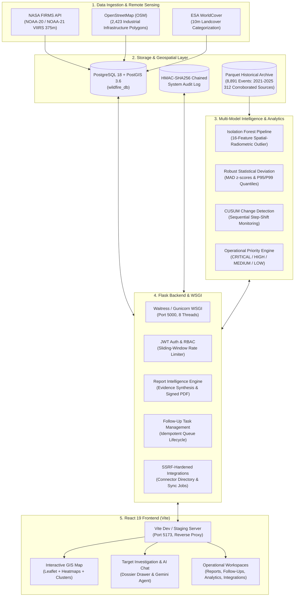

# KRATOS V3.1 — System Architecture & Component Design

KRATOS V3.1 is an enterprise-grade geospatial surveillance platform designed for monitoring, characterizing, and evaluating thermal anomalies across industrial corridors, energy generation infrastructure, and forest landscapes.

## Core Architectural Subsystems

### 1. Ingestion & Spatial Preprocessing
- **Satellite Feeds:** Actively queries NASA FIRMS Area API for NOAA-20 and NOAA-21 VIIRS 375m active fire detections across designated regional bounding boxes.
- **Deduplication:** Spatial-temporal clustering within 500 meters and 90 minutes prevents multiple satellite line-of-sight counts from ballooning hotspot statistics.
- **Facility Association:** PostGIS ST_DWithin and ST_Intersects joins locate thermal detections within 1,000 meters of 2,423 mapped industrial assets.

### 2. Analytical Intelligence Layer
- **Multi-Model Consensus:** Blends multivariate unsupervised machine learning with deterministic statistical methods to reduce false alarms from routine flaring or seasonal agriculture.
- **Deterministic Priority Index:** Produces a standardized priority score (0–100) combining Fire Radiative Power (MW), temperature excursion above baseline, persistence, infrastructure proximity, and environmental vulnerability.

### 3. Application Services & Security
- **Production WSGI:** Dual-stack deployment via Waitress (Windows environments) and Gunicorn (Linux environments) with thread-safe connection pooling.
- **Cryptographic Audit Trail:** Every report creation, status escalation, and connector registration appends a cryptographically chained HMAC-SHA256 entry.
